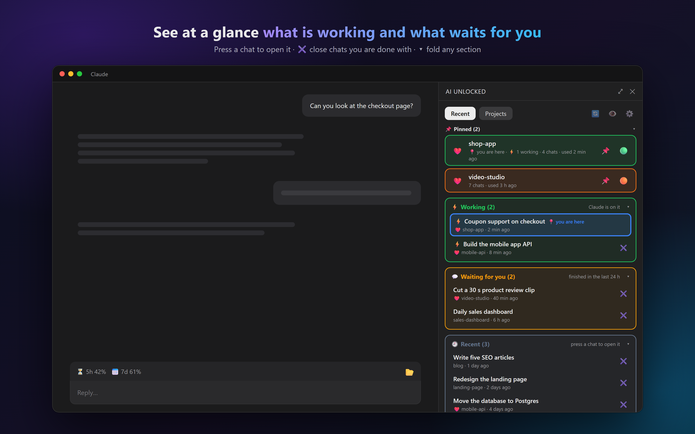
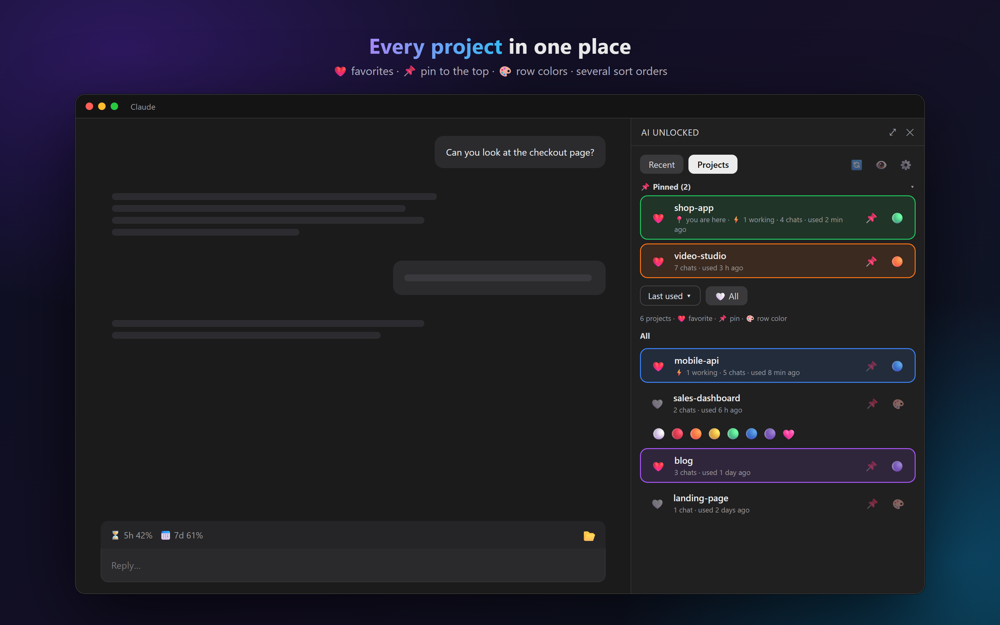

# AI UNLOCKED: projects and chats pane for Claude Code

**English** · [ภาษาไทย](README.th.md)

A Claude Code mod that adds a side pane listing your projects and chats, so you can jump between them quickly.



## What it does

- **Recent tab** with three colored cards:
  - ⚡ **Working**: chats Claude is busy in right now
  - 💬 **Waiting for you**: chats that finished in the last 24 h
  - 🕘 **Recent**: everything else, newest first
  - The chat you are in has a blue frame and a 📍 you are here tag.
- **Press a chat to open it** in the desktop app. In a terminal it copies `claude --resume <id>` instead.
- **✖️ closes a chat** in one press: it stops the chat and archives it. Bring it back from Archived.
- **▾ / ▸** folds each section.



- **Projects tab** groups chats by folder:
  - ❤️ **Favorites**, with a favorites-only filter
  - 📌 **Pins**: pinned projects stay at the top of every tab
  - 🎨 **Row colors**: seven to pick from
  - **Sort by** last used, newest, name, or your own order with ▲▼
  - A project with one chat opens that chat straight away.
- **📁 above the prompt** opens and closes the pane; `/projects` does the same.
- 🔄 refreshes (the pane also refreshes every 20 s while open) · 👁️ shows temp folders too.


- **⚙️ Settings**: Thai or English, and turn each section on or off. Your choices are kept across sessions.

Best in the Claude desktop app, which gives the mod the live session list. In a terminal it reads the transcripts under `~/.claude/projects`.

The pictures above are mockups drawn with sample data.

## Install

At the prompt of a terminal session:

```
/plugin install projects-view --marketplace aiunlocked1412/claude-code-mod-projects-view
```

Answer `y` to add the marketplace, then choose the user scope.

From a shell:

```
claude plugin install projects-view --marketplace aiunlocked1412/claude-code-mod-projects-view
```

In the desktop app, where `/plugin` does not run: click + next to the prompt box, then Plugins, Add marketplace with `aiunlocked1412/claude-code-mod-projects-view`, then Add plugin.

This repository is private: it installs only for people who can read it on GitHub and whose machine already holds a git credential for github.com (an SSH key, or `gh auth login` then `gh auth setup-git`).

After installing, start a new chat or run `/reload-plugins` in an open one.

## Remove

```
claude plugin uninstall projects-view
```
