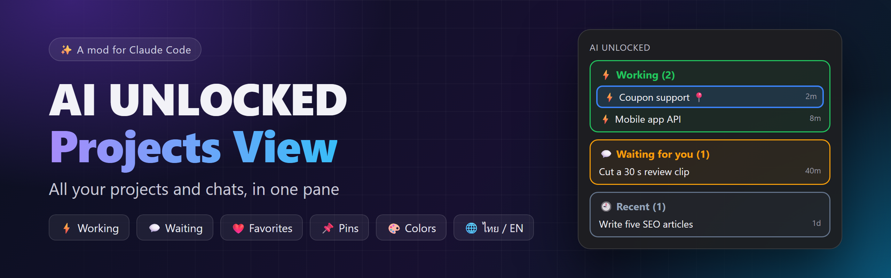
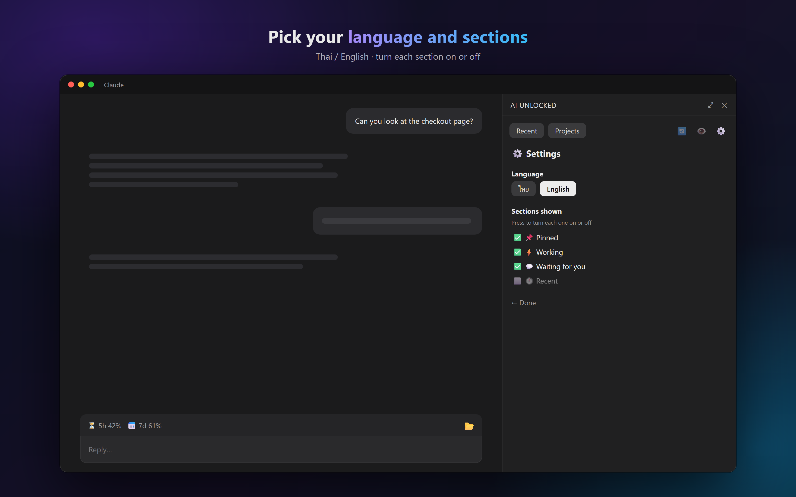

<div align="center">



<h1>AI UNLOCKED · Projects View</h1>

<p><b>A projects and chats pane for Claude Code</b><br>
See at a glance which chats are working and which are waiting for you, then open any of them in one press.</p>

<p>


</p>

<p><b>English</b> · <a href="README.th.md">ภาษาไทย</a></p>

</div>

---

## Contents

- [Why](#why)
- [Features](#features)
- [Install](#install)
- [How to use](#how-to-use)
- [Every control in the pane](#every-control-in-the-pane)
- [FAQ](#faq)
- [Data and privacy](#data-and-privacy)
- [For developers](#for-developers)
- [Uninstall](#uninstall)
- [Credits](#credits)

## Why

After a while with Claude Code you have chats everywhere, spread over many projects. It gets hard to tell which ones Claude is still working in, which ones finished and are waiting for your next message, and which ones you are done with.

**Projects View** puts all of it in one pane beside the chat:

- See right away how many chats are **working** and how many are **waiting for you**
- Open any chat in one press, no hunting through the sidebar
- Pin the projects you use most to the top and give them colors
- Close chats you are done with in one press

## Features

| | Feature | What it does |
|---|---|---|
| ⚡ | **Working** | Chats Claude is busy in right now |
| 💬 | **Waiting for you** | Chats that finished in the last 24 h, waiting for your next message |
| 🕘 | **Recent** | Everything else, newest first |
| 📍 | **You are here** | The chat you are in has a blue frame; its project says so too |
| ❤️ | **Favorites** | Heart the projects you like, then filter to favorites only |
| 📌 | **Pins** | Pinned projects stay at the top of every tab |
| 🎨 | **Row colors** | Seven colors to pick from per project |
| ↕️ | **Sorting** | Last used · newest · name · or your own order with ▲▼ |
| ✖️ | **Close a chat** | Stops it and archives it in one press |
| ▾ | **Fold** | Fold any section; it stays folded next time |
| ⚙️ | **Settings** | Thai / English, and which sections show |
| 📁 | **Toggle** | An icon above the prompt, or type `/projects` |

## Install

> [!NOTE]
> This repository is private. You need an invite to it on GitHub, and a git credential for github.com on your machine: run `gh auth login`, then `gh auth setup-git` (or use an SSH key).

**Claude desktop app**

1. Click **+** next to the prompt box, then **Plugins**
2. Click **Add marketplace** and enter `aiunlocked1412/claude-code-mod-projects-view`
3. Click **Add plugin** on projects-view
4. Start a new chat: a 📁 icon shows above the prompt

**Claude Code in a terminal**

```
/plugin install projects-view --marketplace aiunlocked1412/claude-code-mod-projects-view
```

Answer `y` to add the marketplace, then choose the **user scope**. Or from a shell:

```
claude plugin install projects-view --marketplace aiunlocked1412/claude-code-mod-projects-view
```

With the user scope the mod runs in every chat. In a chat that was already open before you installed, run `/reload-plugins` once.

## How to use

### 1. Open the pane

Press the **📁** icon above the prompt (it sits on the same line as other bands, if you have any) or type `/projects`. A pane named **AI UNLOCKED** opens beside the chat. While it is open the icon turns into 📂; press it again to close.

### 2. Recent tab: what every chat is doing


- Chats sit in three colored cards: 🟢 **Working** · 🟠 **Waiting for you** · ⚪ **Recent**
- **Press a chat's title** to open it in the app
- **Press ✖️** at the end of a row to close a chat you are done with. A working chat is stopped first, then archived.
- The chat you are in has a blue frame and a **📍 you are here** tag, and no ✖️, so you cannot close it by mistake
- Press **▾** on a card's header to fold it, **▸** to open it again
- The pane refreshes every 20 s while open; press 🔄 to refresh now

### 3. Projects tab: keep projects in order


Chats are grouped into projects by the folder they work in. Each row has icon buttons:

| Button | What it does |
|---|---|
| 🤍 / ❤️ | Add to or remove from favorites |
| 📌 | Pin to the top (a faded pin means not pinned) |
| 🎨 | Pick a row color, then press a color dot (⚪ is no color) |
| ▲ ▼ | Move up or down, when sorting by "My order" |

- **Press a project's name** to see its chats. A project with one chat opens that chat straight away.
- **Sort by** one of four: Last used · Newest · Name A-Z · My order
- Press **🤍 All** to switch to **❤️ Favorites only**
- Pinned projects show at the top of every tab; you can hide them in settings

### 4. Settings



Press **⚙️** at the top right of the pane.

- **Language**: Thai or English; every word in the pane changes at once
- **Sections shown**: turn the pinned, working, waiting and recent sections on ✅ or off ⬜
- Your choices are kept, in new chats too

## Every control in the pane

| Control | Where | What it does |
|---|---|---|
| 📁 / 📂 | Above the prompt | Open / close the pane |
| `/projects` | Prompt box | Open / close the pane (same as 📁) |
| Recent · Projects | Top row of the pane | Switch tabs |
| 🔄 | Top row of the pane | Refresh (⏳ while loading) |
| 👁️ / 🙈 | Top row of the pane | Show / hide temp folders |
| ⚙️ | Top row of the pane | Open settings |
| ▾ / ▸ | Each section's header | Fold / unfold |
| ✖️ | End of a chat row | Close the chat (archive it) |

## FAQ

<details>
<summary><b>I don't see the 📁 icon</b></summary>

A chat that was open before you installed has not loaded the mod yet. Run `/reload-plugins` in it, or start a new chat.

If a new chat does not show it either, the list of installed plugins may have been overwritten. Install again:

```
claude plugin install projects-view@claude-code-mod-projects-view --scope user
```
</details>

<details>
<summary><b>How does "Waiting for you" decide?</b></summary>

The app does not report a "waiting" state directly, so the pane counts chats that are **not working** and were **active in the last 24 hours** (up to 10) as waiting for your next message.
</details>

<details>
<summary><b>Can I get a closed chat back?</b></summary>

Yes. ✖️ does not delete a chat; it moves it to the app's **Archived** list, where you can open it again. Work that was stopped midway does not resume by itself.

The app will not archive a chat that is pinned in its own sidebar or open on screen; you then see "Could not close" with the reason.
</details>

<details>
<summary><b>Why has my current chat no ✖️?</b></summary>

Closing the chat the pane runs in would end it at once, so the button is hidden there.
</details>

<details>
<summary><b>Does it work in a terminal?</b></summary>

Yes. Outside the desktop app the pane reads your chats from the files under `~/.claude/projects`, and pressing a chat copies `claude --resume <id>` for you to paste. The Working and Waiting sections need the desktop app.
</details>

<details>
<summary><b>Do all chats share the same favorites and pins?</b></summary>

Yes. Your choices are kept once per machine and every chat uses them.
</details>

## Data and privacy

- The mod runs entirely on your machine and sends nothing anywhere
- The chat list comes from the Claude app on your machine, or from the chat files under `~/.claude/projects`
- Your choices (favorites, pins, colors, order, language) are kept in Claude Code's plugin storage under `~/.claude/plugins/store/`
- Opening a chat uses the app's own `claude://` link

## For developers

```
projects-view/
├── .claude-plugin/
│   ├── plugin.json         name, version, author
│   └── marketplace.json    makes this repo installable in one line
├── hooks/
│   ├── hooks.json          points at register.tsx
│   ├── register.tsx        the mod: pane, buttons, loading
│   ├── i18n.ts             every word in the pane, Thai and English
│   └── register.test.tsx   tests
├── types/index.d.ts        the shapes of what the mod keeps
└── docs/                   pictures
```

Check and test:

```
claude plugin validate .
claude plugin test .
```

## Uninstall

```
claude plugin uninstall projects-view
```

In the desktop app: click **+** > **Plugins** and manage projects-view from there.

## Credits

<div align="center">

Made by **AI UNLOCKED**

<a href="https://aiunlock.co"></a>
<a href="https://www.youtube.com/@AIUnlocked168"></a>
<a href="https://www.facebook.com/aiunlockedvip"></a>

<sub>The pictures on this page are mockups drawn with sample data.</sub>

</div>
