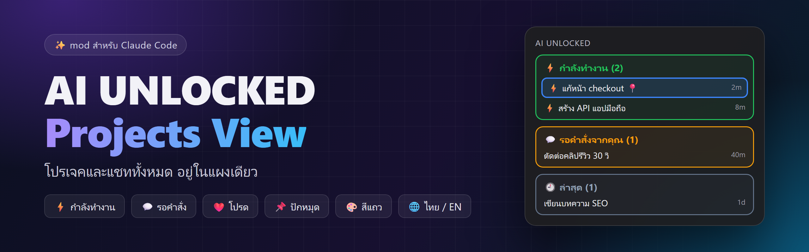
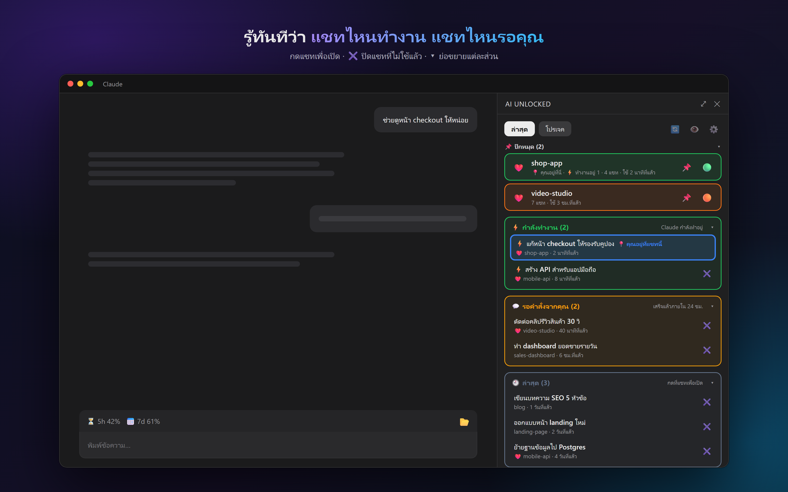
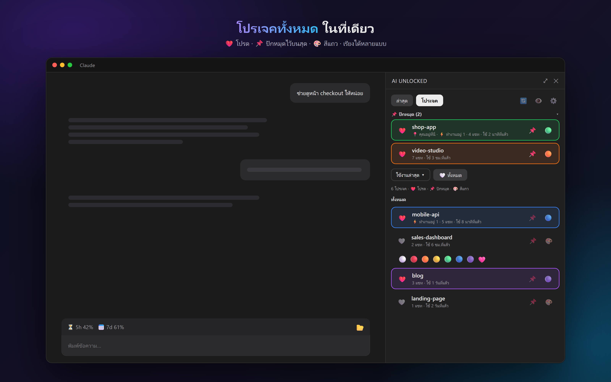
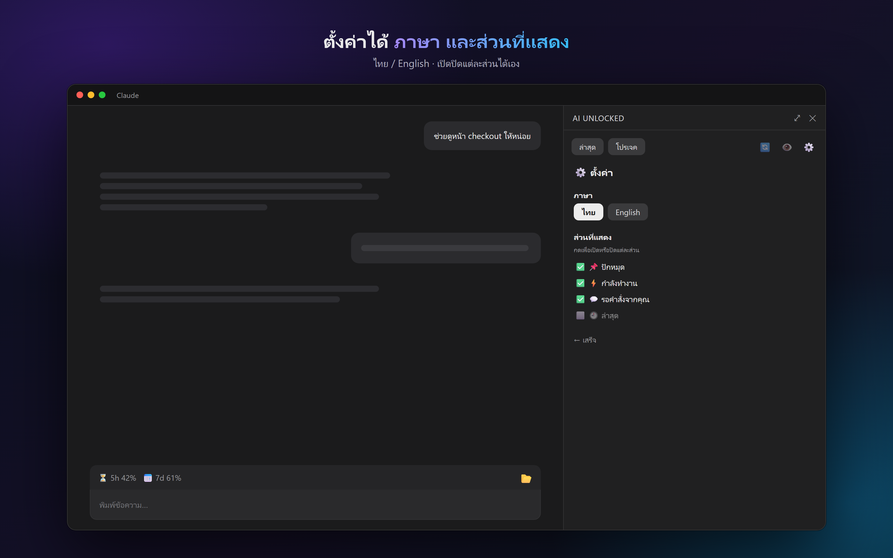

<div align="center">



<h1>AI UNLOCKED · Projects View</h1>

<p><b>แผงโปรเจคและแชทสำหรับ Claude Code</b><br>
รู้ทันทีว่าแชทไหนกำลังทำงาน แชทไหนรอคุณ แล้วกดเดียวก็เปิดแชทนั้นได้เลย</p>

<p>


</p>

<p><a href="README.md">English</a> · <b>ภาษาไทย</b></p>

</div>

---

## สารบัญ

- [ทำไมต้องมี](#ทำไมต้องมี)
- [ความสามารถ](#ความสามารถ)
- [ติดตั้ง](#ติดตั้ง)
- [วิธีใช้](#วิธีใช้)
- [ปุ่มทั้งหมดในแผง](#ปุ่มทั้งหมดในแผง)
- [คำถามที่พบบ่อย](#คำถามที่พบบ่อย)
- [ข้อมูลและความเป็นส่วนตัว](#ข้อมูลและความเป็นส่วนตัว)
- [สำหรับนักพัฒนา](#สำหรับนักพัฒนา)
- [ถอนการติดตั้ง](#ถอนการติดตั้ง)
- [เครดิต](#เครดิต)

## ทำไมต้องมี

ใช้ Claude Code ไปสักพัก แชทจะเยอะขึ้นเรื่อยๆ กระจายอยู่หลายโปรเจค จนจำไม่ได้ว่าแชทไหน Claude ยังทำงานอยู่ แชทไหนทำเสร็จแล้วรอให้เราสั่งต่อ และแชทไหนเลิกใช้ไปแล้ว

**Projects View** รวมทุกอย่างไว้ในแผงเดียวข้างแชท:

- เห็นทันทีว่าตอนนี้มีกี่แชทที่ **กำลังทำงาน** และกี่แชทที่ **รอคุณ**
- กดแชทครั้งเดียวก็เปิดแชทนั้นในแอป ไม่ต้องไล่หาในแถบด้านข้าง
- ปักหมุดโปรเจคที่ใช้บ่อยไว้บนสุด ใส่สีให้แยกออกง่าย
- ปิดแชทที่ไม่ใช้แล้วได้ในคลิกเดียว

## ความสามารถ

| | ความสามารถ | รายละเอียด |
|---|---|---|
| ⚡ | **กำลังทำงาน** | แชทที่ Claude กำลังทำอยู่ตอนนี้ |
| 💬 | **รอคำสั่งจากคุณ** | แชทที่ทำเสร็จแล้วภายใน 24 ชม. รอให้คุณสั่งต่อ |
| 🕘 | **ล่าสุด** | แชทอื่นๆ เรียงจากใหม่ไปเก่า |
| 📍 | **คุณอยู่ที่นี่** | แชทที่เปิดอยู่มีกรอบสีฟ้า โปรเจคของแชทนั้นก็บอกด้วย |
| ❤️ | **โปรด** | ติดหัวใจโปรเจคที่ชอบ แล้วกรองให้เหลือแค่โปรด |
| 📌 | **ปักหมุด** | โปรเจคที่ปักหมุดอยู่บนสุดของทุกแท็บ |
| 🎨 | **สีแถว** | เลือกสีให้โปรเจคได้ 7 สี |
| ↕️ | **เรียงลำดับ** | ใช้งานล่าสุด · สร้างล่าสุด · ชื่อ · หรือเรียงเองด้วย ▲▼ |
| ✖️ | **ปิดแชท** | หยุดงานแล้วเก็บแชทเข้า Archived ในคลิกเดียว |
| ▾ | **ย่อ / ขยาย** | พับแต่ละส่วนเก็บไว้ จำไว้ทุกครั้งที่เปิด |
| ⚙️ | **ตั้งค่า** | ภาษาไทย / English และเลือกส่วนที่จะแสดง |
| 📁 | **ปุ่มเปิดปิด** | ไอคอนเหนือช่องพิมพ์ หรือพิมพ์ `/projects` |

## ติดตั้ง

> [!NOTE]
> repository นี้เป็น private ต้องได้รับเชิญเข้า repo บน GitHub ก่อน และในเครื่องต้องตั้ง GitHub ไว้แล้ว: รัน `gh auth login` แล้วตามด้วย `gh auth setup-git` (หรือใช้ SSH key)

**แอป Claude เดสก์ท็อป**

1. กด **+** ข้างช่องพิมพ์ แล้วเลือก **Plugins**
2. กด **Add marketplace** แล้วใส่ `aiunlocked1412/claude-code-mod-projects-view`
3. กด **Add plugin** ที่ projects-view
4. เปิดแชทใหม่ จะเห็นไอคอน 📁 เหนือช่องพิมพ์

**Claude Code ใน terminal**

```
/plugin install projects-view --marketplace aiunlocked1412/claude-code-mod-projects-view
```

ตอบ `y` เพื่อเพิ่ม marketplace แล้วเลือก **user scope** หรือติดตั้งจาก shell:

```
claude plugin install projects-view --marketplace aiunlocked1412/claude-code-mod-projects-view
```

ติดตั้งแบบ user scope แล้ว mod จะทำงานในทุกแชท แชทที่เปิดค้างไว้ก่อนติดตั้งให้รัน `/reload-plugins` หนึ่งครั้ง

## วิธีใช้

### 1. เปิดแผง

กดไอคอน **📁** เหนือช่องพิมพ์ (อยู่แถวเดียวกับแถบอื่นๆ ถ้ามี) หรือพิมพ์ `/projects` แผงชื่อ **AI UNLOCKED** จะเปิดข้างแชท ตอนเปิดอยู่ไอคอนจะเปลี่ยนเป็น 📂 กดอีกครั้งเพื่อปิด

### 2. แท็บล่าสุด: ดูว่าแชทไหนทำอะไรอยู่



- แชทแบ่งเป็น 3 การ์ดสี: 🟢 **กำลังทำงาน** · 🟠 **รอคำสั่งจากคุณ** · ⚪ **ล่าสุด**
- **กดชื่อแชท** เพื่อเปิดแชทนั้นในแอป
- **กด ✖️** ท้ายแถวเพื่อปิดแชทที่ไม่ใช้แล้ว ถ้าแชทนั้นกำลังทำงานอยู่ จะหยุดงานก่อน แล้วเก็บเข้า Archived
- แชทที่คุณเปิดอยู่มีกรอบสีฟ้าและป้าย **📍 คุณอยู่ที่แชทนี้** และไม่มีปุ่ม ✖️ กันปิดแชทตัวเองพลาด
- กด **▾** ที่หัวการ์ดเพื่อพับเก็บ กด **▸** เพื่อกางออก
- แผงรีเฟรชเองทุก 20 วินาทีตอนเปิดอยู่ กด 🔄 เพื่ออัปเดตทันที

### 3. แท็บโปรเจค: จัดระเบียบโปรเจค



แชทถูกรวมเป็นโปรเจคตามโฟลเดอร์ที่ใช้ทำงาน แต่ละแถวมีปุ่มไอคอน:

| ปุ่ม | ทำอะไร |
|---|---|
| 🤍 / ❤️ | เพิ่มหรือเอาออกจากรายการโปรด |
| 📌 | ปักหมุดไว้บนสุด (หมุดจางคือยังไม่ได้ปัก) |
| 🎨 | เลือกสีแถว แล้วกดวงกลมสีที่ต้องการ (⚪ คือไม่มีสี) |
| ▲ ▼ | เลื่อนลำดับ เมื่อเลือก "เรียงเอง" |

- **กดชื่อโปรเจค** เพื่อดูแชทข้างใน ถ้าโปรเจคมีแชทเดียวจะเปิดแชทนั้นเลย
- เลือก **เรียงตาม** ได้ 4 แบบ: ใช้งานล่าสุด · สร้างล่าสุด · ชื่อ ก-ฮ / A-Z · เรียงเอง
- กด **🤍 ทั้งหมด** เพื่อสลับเป็น **❤️ เฉพาะโปรด**
- โปรเจคที่ปักหมุดจะแสดงบนสุดของทุกแท็บ และในหน้าตั้งค่าก็ซ่อนได้

### 4. ตั้งค่า



กด **⚙️** มุมขวาบนของแผง

- **ภาษา**: ไทย หรือ English เปลี่ยนทุกคำในแผงทันที
- **ส่วนที่แสดง**: กดเพื่อเปิด ✅ หรือปิด ⬜ ส่วนปักหมุด กำลังทำงาน รอคำสั่ง และล่าสุด
- ค่าที่ตั้งไว้จำไว้ แม้เปิดแชทใหม่

## ปุ่มทั้งหมดในแผง

| ปุ่ม | อยู่ที่ | ทำอะไร |
|---|---|---|
| 📁 / 📂 | เหนือช่องพิมพ์ | เปิด / ปิดแผง |
| `/projects` | ช่องพิมพ์ | เปิด / ปิดแผง (เหมือน 📁) |
| ล่าสุด · โปรเจค | แถวบนของแผง | สลับแท็บ |
| 🔄 | แถวบนของแผง | รีเฟรชรายการ (⏳ ระหว่างโหลด) |
| 👁️ / 🙈 | แถวบนของแผง | แสดง / ซ่อนโฟลเดอร์ชั่วคราว |
| ⚙️ | แถวบนของแผง | เปิดหน้าตั้งค่า |
| ▾ / ▸ | หัวแต่ละส่วน | ย่อ / ขยาย |
| ✖️ | ท้ายแถวแชท | ปิดแชท (เก็บเข้า Archived) |

## คำถามที่พบบ่อย

<details>
<summary><b>ไม่เห็นไอคอน 📁 ในแชท</b></summary>

แชทที่เปิดไว้ก่อนติดตั้งยังไม่โหลด mod ให้รัน `/reload-plugins` ในแชทนั้น หรือเปิดแชทใหม่

ถ้าแชทใหม่ก็ยังไม่เห็น อาจเป็นเพราะรายการปลั๊กอินที่ติดตั้งถูกเขียนทับ ให้ติดตั้งซ้ำ:

```
claude plugin install projects-view@claude-code-mod-projects-view --scope user
```
</details>

<details>
<summary><b>"รอคำสั่งจากคุณ" นับยังไง</b></summary>

แอปไม่ได้บอกสถานะ "รอคำสั่ง" มาตรงๆ แผงจึงนับแชทที่ **ไม่ได้ทำงานอยู่** และ **มีการใช้งานภายใน 24 ชม.** (สูงสุด 10 แชท) ว่ากำลังรอคำสั่งต่อจากคุณ
</details>

<details>
<summary><b>ปิดแชทแล้วเอากลับมาได้ไหม</b></summary>

ได้ ✖️ ไม่ได้ลบแชท แค่เก็บเข้ารายการ **Archived** ของแอป เปิดคืนได้จากตรงนั้น แต่งานที่ถูกหยุดกลางทางจะไม่ทำต่อเอง

แอปจะไม่ยอมเก็บแชทที่ปักหมุดไว้ในแถบด้านข้างของแอป หรือแชทที่เปิดอยู่บนจอ ถ้าเจอแบบนี้จะมีข้อความ "ปิดไม่ได้" พร้อมเหตุผล
</details>

<details>
<summary><b>ทำไมแชทที่ฉันอยู่ไม่มีปุ่ม ✖️</b></summary>

ถ้าปิดแชทที่แผงเปิดอยู่ แชทนั้นจะจบทันที จึงซ่อนปุ่มไว้กันกดพลาด
</details>

<details>
<summary><b>ใช้ใน terminal ได้ไหม</b></summary>

ได้ ถ้าไม่ได้อยู่ในแอปเดสก์ท็อป แผงจะอ่านรายการแชทจากไฟล์ใน `~/.claude/projects` แทน และกดที่แชทจะคัดลอกคำสั่ง `claude --resume <id>` ให้ไปวางใน terminal ส่วนกำลังทำงานและรอคำสั่งมีเฉพาะในแอปเดสก์ท็อป
</details>

<details>
<summary><b>แต่ละแชทเห็นดาวและหมุดเหมือนกันไหม</b></summary>

เหมือนกัน ค่าที่ตั้งไว้เก็บไว้ที่เดียวต่อเครื่อง ทุกแชทใช้ร่วมกัน
</details>

## ข้อมูลและความเป็นส่วนตัว

- mod ทำงานในเครื่องคุณทั้งหมด ไม่ส่งข้อมูลออกไปที่ไหน
- รายการแชทมาจากแอป Claude ในเครื่อง หรือจากไฟล์แชทใน `~/.claude/projects`
- ค่าที่ตั้งไว้ (โปรด หมุด สี ลำดับ ภาษา) เก็บในพื้นที่เก็บข้อมูลของ Claude Code ที่ `~/.claude/plugins/store/`
- การเปิดแชทใช้ลิงก์ `claude://` ของแอปเอง

## สำหรับนักพัฒนา

```
projects-view/
├── .claude-plugin/
│   ├── plugin.json         ชื่อ เวอร์ชัน ผู้สร้าง
│   └── marketplace.json    ทำให้ repo นี้ติดตั้งได้ด้วยบรรทัดเดียว
├── hooks/
│   ├── hooks.json          ชี้ไปที่ register.tsx
│   ├── register.tsx        ตัว mod: แผง ปุ่ม การโหลดข้อมูล
│   ├── i18n.ts             คำทั้งหมดในแผง ไทย / อังกฤษ
│   └── register.test.tsx   test
├── types/index.d.ts        ชนิดข้อมูลที่ mod เก็บ
└── docs/                   ภาพประกอบ
```

ตรวจและรัน test:

```
claude plugin validate .
claude plugin test .
```

## ถอนการติดตั้ง

```
claude plugin uninstall projects-view
```

ในแอปเดสก์ท็อป: กด **+** > **Plugins** แล้วจัดการ projects-view จากตรงนั้น

## เครดิต

<div align="center">

สร้างโดย **AI UNLOCKED**

<a href="https://aiunlock.co"></a>
<a href="https://www.youtube.com/@AIUnlocked168"></a>
<a href="https://www.facebook.com/aiunlockedvip"></a>

<sub>ภาพในหน้านี้เป็นภาพจำลองที่ใช้ข้อมูลตัวอย่าง</sub>

</div>
